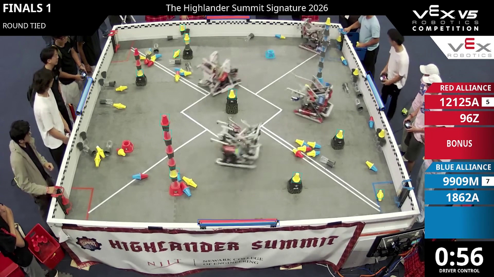

# RoboCoach

**[Open RoboCoach](https://therealbnaru.github.io/RoboCoach/)**

RoboCoach is a browser app for VEX V5 robotics teams to review matches, scout teams, plan autonomous routines, and develop computer-vision-assisted scoring for Override.

The long-term goal is an AI coach that connects video evidence, score swings, autonomous performance, and scouting information to explain **how a match unfolded, why a team may have lost, and what to practice or change next**.

This is an active prototype. Video review, scouting, route planning, manual score calculation, and experimental Toggle detection are implemented. Full automatic match scoring and the coaching chatbot are planned.

## What you can use today

### Video review and annotations

- Import local match videos into an Explorer-style library with folders, renaming, and deletion.
- Play, pause, seek, adjust volume, and enter fullscreen.
- Draw on paused frames using a pen, colors, and eraser; undo strokes with Ctrl+Z.
- Add timestamped notes and revisit annotated moments through timeline markers.
- Open YouTube videos or livestreams for embedded playback.
- Share a browser tab to review captured footage, including a playing YouTube source.
- Draw temporary annotations over a playing shared feed, or use **Freeze & Annotate**.
- Name and save a frozen annotation to the Explorer, with an optional source-video link.

Direct YouTube playback and shared-tab capture are different modes. The embedded YouTube player is for viewing; drawing and frame processing use uploaded video or a shared feed. Freezing a captured frame does not pause the original source tab.

### Scouting and autonomous planning

- Record match observations, pit information, robot type, and notes.
- Rate scoring, game sense/driving, autonomous performance, and compatibility.
- Filter scouting results by event, sort teams, and view a team's history across events.
- Import World Skills CSV data, including rank, total score, and driving/programming breakdowns; open a team's OpenScout page.
- Use a scrollable results panel or expand results to fullscreen.
- Maintain a profile for your own robot and save autonomous routines.
- Draw routes on the Override field, move nodes, undo edits, and add routes through tabs.
- Name routes with an alliance-color prefix, such as **red split auto**.
- Select profile routines to consider running with or against a scouted team.
- Import and export scouting entries.

Skills data uses CSV import; this is not an automatic OpenScout statistics feed.

### Scoring and Toggle detection

The **Live score** panel works alongside uploaded-video playback and shared-tab feeds.

- Color-coded +/− controls enter scoring Pin-half counts.
- Red/Neutral/Blue buttons set Toggle ownership.
- Midfield robot counts and autonomous bonuses contribute to the projected score.
- A trained ONNX model can locate Toggles in the browser.
- **Dev mode** displays rotated detection boxes, confidence values, and detection status.
- **Pick on video** assigns a detected Toggle to Left, Right, Top, or Bottom and calibrates its field-facing color strip.
- A white dot shows the sampled location. Two matching color readings update the ownership buttons and calculated score.

Detection/color checks run about once per second when active; actual speed depends on the device. The interface keeps the previous state when a reading is unclear.

**Current limits:** Pin and cup scoring inputs are manual. The Toggle model locates the object; a separate color sampler estimates its state. The sampler follows a calibrated location relative to the detected box, but substantial camera movement, changed perspective, or occlusion may require recalibration. Model predictions are not official referee scores.

## Research artifacts you can inspect

- [Downloadable model checkpoints and ONNX](./models/README.md)
- [Training workflow, experiment results, and limitations](./docs/TRAINING.md)
- [Configurable training notebook](./notebooks/train_obb.ipynb)
- [Original development notebook, cleaned of outputs](./notebooks/YOLO_OVERRIDE_DETECTION.ipynb)
- [Toggle training results](./experiments/toggle/results.csv) and [pins/cups training results](./experiments/pins/results.csv)

This is a validation-frame preview from the early pins/cups experiment, not proof of complete scoring or independent-video accuracy. See the training guide for footage attribution and evaluation details.

## Computer vision work completed

### Dataset and training workflow

The project has progressed through:

1. Collecting match footage from multiple recordings and camera viewpoints.
2. Labeling rotated bounding boxes in **CVAT**.
3. Exporting images and annotations, including CVAT XML tracks.
4. Converting rotated boxes into normalized **YOLO OBB** labels and validating coordinates.
5. Training and evaluating **YOLO26n-OBB** models in **Google Colab**, including CPU runtimes.
6. Saving datasets, checkpoints, and preview images in Google Drive.
7. Testing on an additional match video (Q6).
8. Exporting a trained Toggle model to **ONNX** and adding browser inference and visual debugging.

A track can contain interpolated boxes. Those boxes need review, especially when the camera moves or objects disappear. Pin labels represent **individual colored halves**, not an entire connected multicolor pin.

### Toggle model

The expanded Toggle dataset used **78 training images** and **36 validation images**. The 50-epoch run's final logged validation results were approximately:

| Metric | Final epoch |
| --- | ---: |
| Precision | 92.9% |
| Recall | 90.9% |
| mAP50 | 91.8% |
| mAP50–95 | 51.7% |

These describe that validation split, not guaranteed performance on every match or automatic scoring accuracy. The exported checkpoint is the run's selected **best.pt**, which may come from a different epoch.

The current app accepts single-class, 640×640 raw ONNX outputs shaped **[1, 5, N]** for detection or **[1, 6, N]** for OBB, with NMS off. The exported Toggle model produced **[1, 6, 8400]**.

### Pins and cups: first five-class experiment

The next dataset introduced:

| Class ID | Label | Meaning |
| --- | --- | --- |
| 0 | Toggle | Toggle object |
| 1 | red_pin | Individual red pin half |
| 2 | blue_pin | Individual blue pin half |
| 3 | yellow_pin | Individual yellow pin half |
| 4 | cup | Cup object |

The first 50 sampled timesteps contained **2,010 boxes** and were split into **40 training images** and **10 validation images**. A 50-epoch run completed with these best-checkpoint validation results:

| Class | Precision | Recall |
| --- | ---: | ---: |
| Toggle | 85.1% | 100% |
| Red pin half | 30.8% | 26.4% |
| Blue pin half | 7.4% | 38.8% |
| Yellow pin half | 13.2% | 84.3% |
| Cup | 22.6% | 45.1% |

This is an early experiment: validation comes from the same video, and pin/cup detection is not yet reliable. Individual previews at lower confidence thresholds show more candidate halves, but lowering the threshold can also increase false detections.

**The five-class model is not integrated into the app yet.** More varied labeling, annotation review, and evaluation are the current priorities. Old Toggle-only frames cannot simply be treated as fully labeled examples for the new classes.

## Roadmap toward an AI coach

### 1. Reliable object detection

- Expand labels across venues, lighting, camera angles, stacks, piles, and partial obstructions.
- Improve red/blue pin-half and cup recognition.
- Evaluate resolution and augmentation settings for small, color-specific objects.
- Test on held-out match videos and report per-class results.
- Extend browser inference to the five-class model.

### 2. Understand field state and estimate score

Object detection alone cannot determine the score. RoboCoach needs to establish scoring areas and relationships: which halves belong to which stacks or cups, what is settled versus moving, and which alliance owns each relevant area.

Planned work includes camera/field calibration, handling moving cameras, temporal consistency, duplicate prevention, uncertainty indicators, and manual corrections. Score rules should be calculated explicitly from structured field state.

### 3. Build a match timeline

Record timestamped observations and score estimates, including:

- Alliance score changes and lead changes.
- Toggle ownership changes.
- Autonomous outcomes and missed opportunities.
- Scoring cycles, interruptions, and other observable events.
- Human notes, corrections, and confidence in the underlying evidence.

Connecting events to timestamps will let teams return to the footage behind an explanation.

### 4. Add an LLM coaching assistant

The end-goal chatbot will reason from the match timeline, score breakdown, video-linked observations, team profile, and scouting history.

Example questions:

> Where did we lose our lead?

> How much did Toggle control affect this match?

> Was autonomous the deciding factor, or did our scoring slow down later?

> What should we practice before the next event?

The intended output is a useful coaching explanation: identify decisive moments, explain their likely impact, and suggest concrete changes to autonomous selection, coordination, priorities, or practice.

The assistant should distinguish observations from hypotheses, reference supporting timestamps, and acknowledge missing or uncertain evidence. A score swing can identify a turning point; explaining its cause requires match context. Scenario comparisons would be estimates, not proof of what would have happened.

**No LLM/chatbot or automatic loss explanation is implemented yet.**

## Running and storing data

Use the **[hosted app](https://therealbnaru.github.io/RoboCoach/)**, or serve the repository through a local HTTP server. Desktop browsers are needed for shared-tab capture.

App videos, reviews, profiles, and scouting data are stored locally in the browser. Browser storage does not automatically synchronize between devices. Scouting exports can be used to transfer entries.

Training currently happens separately in Colab, with datasets and model artifacts saved in Drive. Loading an ONNX file runs inference; it does not retrain the model. User corrections do not automatically teach the model until they are incorporated into a reviewed dataset and a later training run.

## Source layout

| File | Purpose |
| --- | --- |
| [index.html](./index.html) | App structure and controls |
| [styles.css](./styles.css) | Layout and styling |
| [app.js](./app.js) | Video review, local storage, scouting, planners, scoring, and browser inference |

The app is hosted on GitHub Pages. Cleaned notebooks, selected model weights, and evaluation artifacts are now included in this repository. Full training videos and datasets remain separately managed in Drive. See the research links above.
