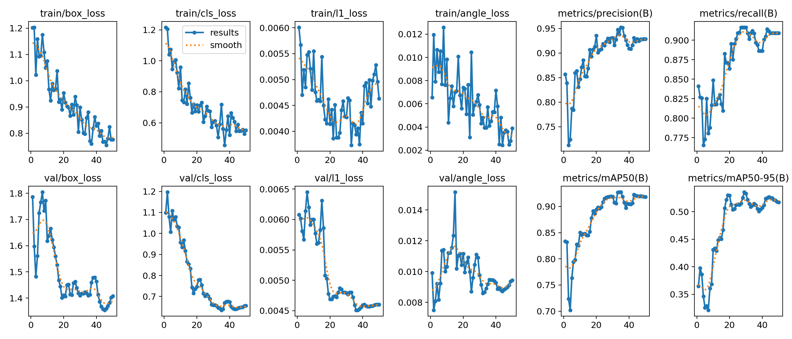
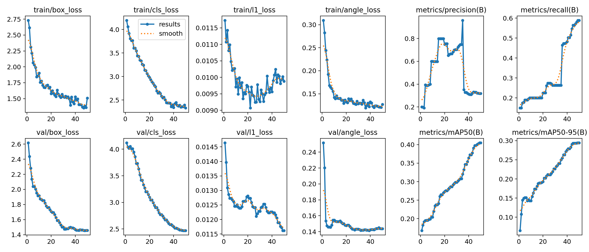
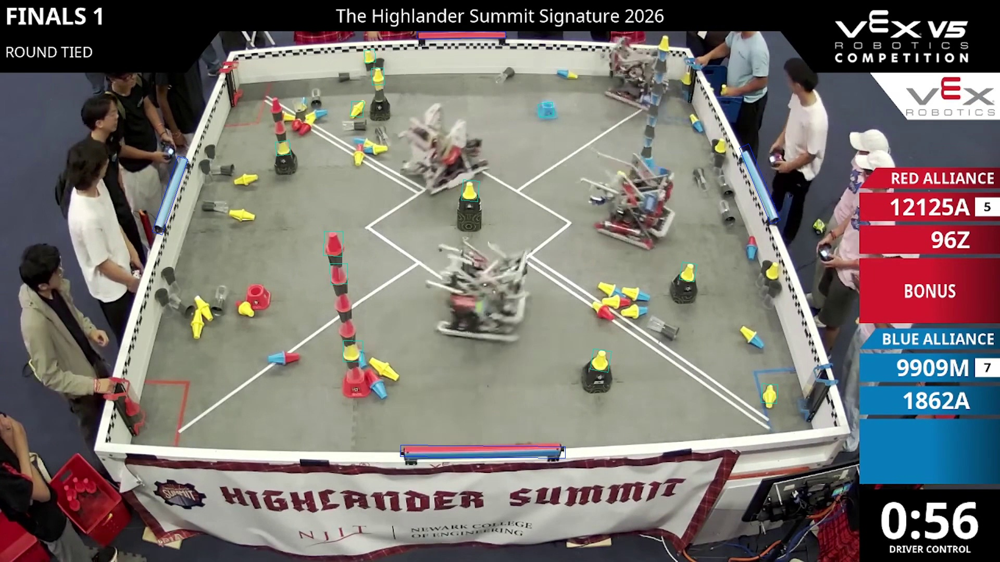

# Training and experiment record

This folder documents the computer vision work behind RoboCoach. The application is a static browser app; model training is a separate Python/Colab workflow.

## Included artifacts

- [Historical development notebook](../notebooks/YOLO_OVERRIDE_DETECTION.ipynb): source cells from the author's actual notebook, with all outputs and transient metadata removed. It includes exploratory work and is **not** a run-all pipeline.
- [Configurable training notebook](../notebooks/train_obb.ipynb): a new reference workflow for a prepared, reviewed OBB dataset.
- [Model checkpoints and compatibility](../models/README.md).
- [Toggle experiment](../experiments/toggle/) and [pins/cups experiment](../experiments/pins/): original per-epoch CSVs, training plots, confusion matrices, validation-label/prediction pairs, and sanitized run arguments.

The reference notebook is documentation, not a claim that the archived experiments can be reproduced without their original data. It has not been executed end to end during repository packaging.

## Dataset preparation

Use CVAT rotated rectangles. Export images plus annotations. CVAT interpolation XML can contain a box for every sampled timestep, including boxes interpolated between manual keyframes. Review these intermediate boxes for drift before using them as ground truth. Skip outside=1 boxes; partially obscured objects require a consistent annotation policy.

Convert each rectangle's center, dimensions, and rotation to four corner coordinates, normalized by the actual image dimensions. A YOLO OBB label row is:

```text
class_id x1 y1 x2 y2 x3 y3 x4 y4
```

Validate class IDs, positive box size, finite coordinates, and bounds. Report problematic edge boxes for review instead of silently deleting or moving them.

Historical note: early Toggle preparation removed one out-of-bounds Q4 box and shifted 12 validation boxes inside the image. Those edits are preserved in the historical notebook for transparency. They can affect metrics; use the same reviewed validation version when comparing models.

### Class mappings

| ID | Toggle-only model | Five-class experiment |
| --- | --- | --- |
| 0 | toggle | Toggle |
| 1 | — | red_pin |
| 2 | — | blue_pin |
| 3 | — | yellow_pin |
| 4 | — | cup |

Each pin class represents **one colored half**, not the whole connected multicolor object. Label all identifiable objects of the dataset's classes in every selected image. Do not add Toggle-only images to five-class training without labeling their pins and cups.

Prepared directory layout:

```text
dataset/
  data.yaml
  images/train/
  images/val/
  labels/train/
  labels/val/
```

Example five-class configuration:

```yaml
path: /absolute/path/to/dataset
train: images/train
val: images/val
names:
  0: Toggle
  1: red_pin
  2: blue_pin
  3: yellow_pin
  4: cup
```

## Experiment history

### Toggle-only: toggle-obb-with-online

- YOLO26n-OBB; 78 training images and 36 validation images.
- Continued from the preceding Toggle checkpoint; 50 additional epochs, imgsz=640, batch=16, CPU.
- Class 0 is toggle. The linked artifacts come from this exact run.
- Final epoch: precision 0.92878, recall 0.90909, mAP50 0.91844, mAP50–95 0.51683.
- Those numbers are the **last CSV row**, not a separately recomputed evaluation of the bundled best checkpoint.

[Per-epoch metrics](../experiments/toggle/results.csv)



### Five-class: pins-cups-obb

- 50 sampled timesteps from one match, containing 2,010 labeled boxes.
- First 40 images used for training; last 10 used for validation.
- 50 epochs, imgsz=640, batch=16, CPU, initialized from the Toggle-only checkpoint.
- Neighboring frames in a single video are correlated. This validation split does not establish generalization to other matches.
- Final epoch aggregate precision 0.31856, recall 0.58913, mAP50 0.40507, mAP50–95 0.29439.
- The console evaluation of best.pt reported the following rounded per-class values:

| Class | Precision | Recall | mAP50 |
| --- | ---: | ---: | ---: |
| Toggle | 0.851 | 1.000 | 0.995 |
| red_pin | 0.308 | 0.264 | 0.0867 |
| blue_pin | 0.0741 | 0.388 | 0.111 |
| yellow_pin | 0.132 | 0.843 | 0.515 |
| cup | 0.226 | 0.451 | 0.319 |

[Per-epoch metrics](../experiments/pins/results.csv)



The model is experimental. Lowering a display confidence threshold reveals additional candidates; it does not improve the trained weights or guarantee correct class assignments.



This preview is frame 005040 from the validation sequence, generated at conf=0.25 with labels/confidence text hidden. It is not an independent test. Source footage: VEX Vault, “Full Finals | The Highlander Summit Signature | 12125A & 96Z vs 9909M & 1862A | VEX Override” ([YouTube](https://www.youtube.com/watch?v=lARnTwHYdVQ)). Source footage remains the property of its respective rights holders; this repository does not grant rights to the original footage.

## Run an experiment

Open the reference notebook in Colab or Jupyter. Set your checkout, dataset YAML, checkpoint, output directory, and device explicitly. CPU works; CUDA device 0 requires an actual available NVIDIA GPU. Colab runtimes are temporary, so reinstall dependencies and remount Drive after a reset.

Keep validation separate from training. Prefer a held-out match/video, review annotations before training, and retain an untouched test video for final checks.

Use a new run name. Keep best.pt for selected-checkpoint evaluation and future fine-tuning. Interrupted training may resume from an unstripped last.pt checkpoint; completed runs can have optimizer state removed.

For a less cluttered preview, request individual images with show_labels=False, show_conf=False, line_width=1. Record the confidence threshold with the preview.

## Export and app compatibility

```python
from ultralytics import YOLO

YOLO("models/toggle/best.pt").export(
    format="onnx", imgsz=640, opset=17,
    dynamic=False, simplify=True, nms=False, device="cpu",
)
```

The supplied ONNX has input [1, 3, 640, 640] and output [1, 6, 8400]. Its class and shapes were inspected directly from the file. Inference was not executed as part of packaging.

The Toggle loader supports single-class Toggle models. The separate pins-and-goals loader supports the current two-class raw OBB model described below. The historical five-class checkpoint is not compatible with either loader.

## Next experiments

- Add reviewed frames from other matches with red/blue halves, cups, sideways pieces, piles, and occlusions.
- Inspect interpolation errors and missing labels.
- Compare small-object performance at higher resolution, with appropriate runtime/memory tradeoffs.
- Evaluate color-preserving augmentation choices.
- Test on independent videos before integrating automatic pin/cup counting.
- Keep object detection metrics separate from scoring and coaching accuracy.


## Stacked-pin and goal development

The initial color-specific pin classes were merged into a single pin-half class, with color sampling explored separately. The training set grew from four hand-labeled screenshots (116 pin halves), to seven (162), thirteen (257), and fourteen (268, including one reviewed Skills frame). Labels temporarily named Toggle in the pin-only screenshot exports were remapped only where they represented pin halves; actual Toggles in Skills footage were excluded from the pin dataset. Cups were removed from this model.

Small-dataset diagnostics exposed too few optimizer updates with batch=4 and nbs=64. Subsequent runs used batch=4 and nbs=4, with warmup_epochs=0, so gradient accumulation did not stretch across many tiny epochs. Diagnostic fine-tuning disabled geometric and HSV augmentations. This was a controlled small-data setup, not an established optimal training recipe.

### pins-goals-100

- Source export: Full Finals goals pins.zip; labels PIN and Goals remapped to stacked_pin_half (0) and goal (1).
- CVAT step=100, start_frame=0; selected sampled timesteps 0 through 43 inclusive.
- Missing exported image timesteps: 0, 30, 31, 34, 35, 40. Used the remaining 38 without inventing images or labels.
- First 30 available images: 393 pin-half boxes and 210 goal boxes.
- Final 8 available images: 231 pin-half boxes and 56 goal boxes.
- Continued from stacked-pins-with-skills-100/weights/best.pt; 100 epochs, imgsz=960, batch=nbs=4, AdamW lr0=0.0003, warmup_epochs=0, CPU. Training completed in 1.823 hours.
- The class head was expanded from one to two classes, retaining the matching pin class by name.
- Metrics below are from the console validation of the selected best.pt, as supplied by the author; latest weights, CSVs, and preview images have not been added to this repository.

| Class | Precision | Recall | mAP50 | mAP50–95 |
| --- | ---: | ---: | ---: | ---: |
| stacked_pin_half | 0.951 | 0.775 | 0.915 | 0.753 |
| goal | 0.851 | 0.893 | 0.875 | 0.783 |
| all | 0.901 | 0.834 | 0.895 | 0.768 |

The split is chronological within one video. Adjacent frames are correlated; these metrics do not measure performance on new venues or camera angles, and are not scoring accuracy. Historical validation sets and class policies differ, so do not interpret their mAP differences as a controlled comparison.

### Pins and goals browser preview

Export the latest checkpoint in Colab:

```python
from ultralytics import YOLO

exported = YOLO(
    "/content/drive/MyDrive/RoboCoach/pins-goals-100/weights/best.pt"
).export(
    format="onnx", imgsz=960, batch=1,
    dynamic=False, half=False, opset=17, simplify=True,
    end2end=False, nms=False,
)
```

The browser expects float32 input [1,3,960,960] and raw output [1,7,N]: center x/y, width/height, two class confidence channels, and angle in radians. Class 0 must be stacked_pin_half and class 1 goal. An incompatible output is rejected with an explanatory message. This contract is implemented in the loader; the latest exported artifact has not yet been independently inspected or run in the browser.

Download the export and open RoboCoach. Open a local video or share a browser tab, click Live score, and choose the ONNX under Pins and goals model. Keep Show boxes checked. Blue boxes represent pin halves; green boxes represent goals. The confidence slider defaults to 0.25. The existing Toggle model can remain loaded separately.

The preview applies letterboxing, class-aware rotated-box duplicate suppression, and displays counts without box-label text. It does not assign goal identities, sample pin colors, prove stack support, or change manual scoring counts. Synthetic runtime checks covered loading, letterbox inference, duplicate filtering across classes, box colors, unloading, and incompatible-export rejection; actual exported-model browser verification remains pending.

Next steps are independent-video evaluation, robust pin-to-goal association with uncertainty and manual correction, temporal tracking, and only then structured score events for the planned LLM coach. A nearby goal in a 2D image alone is not proof that a pin is scored.
